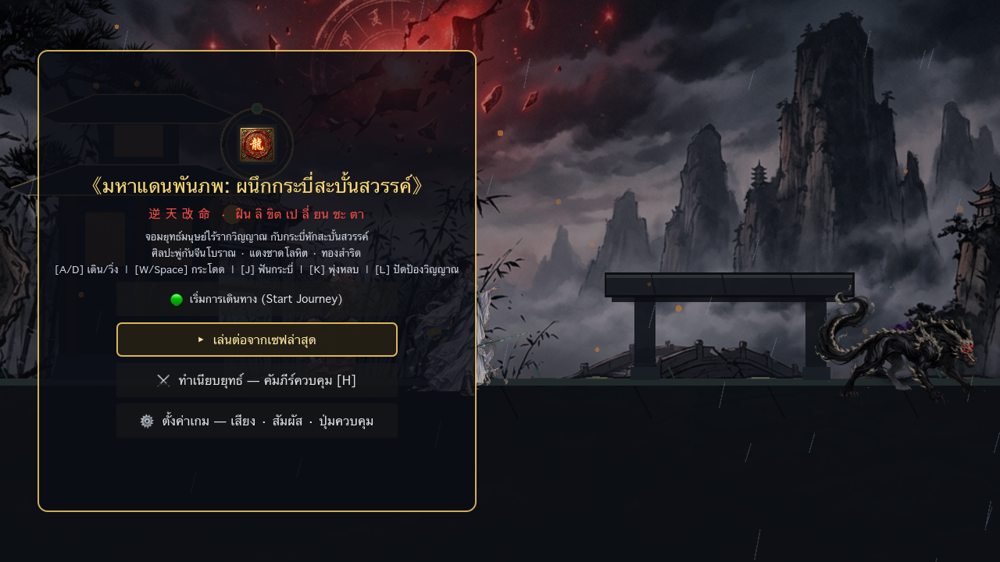
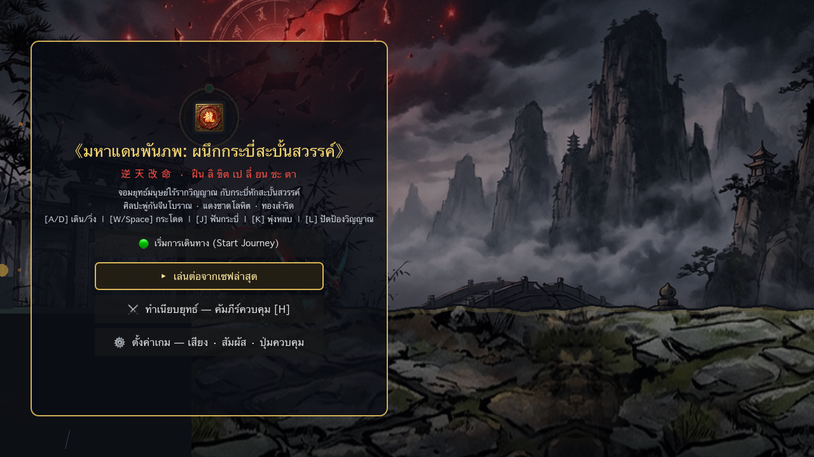
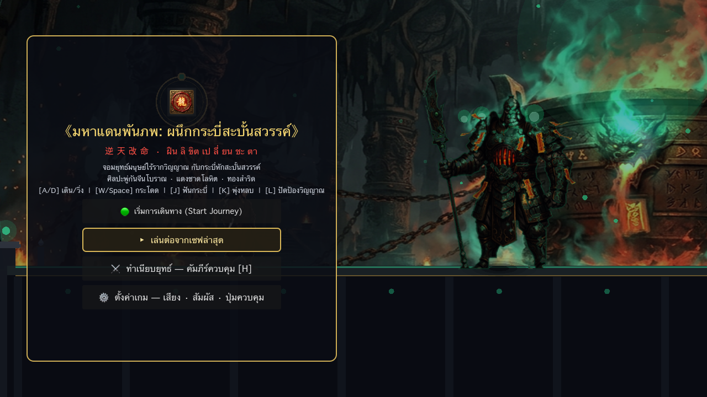
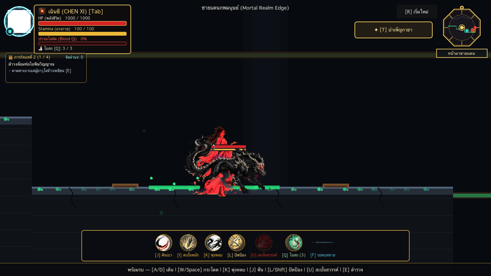
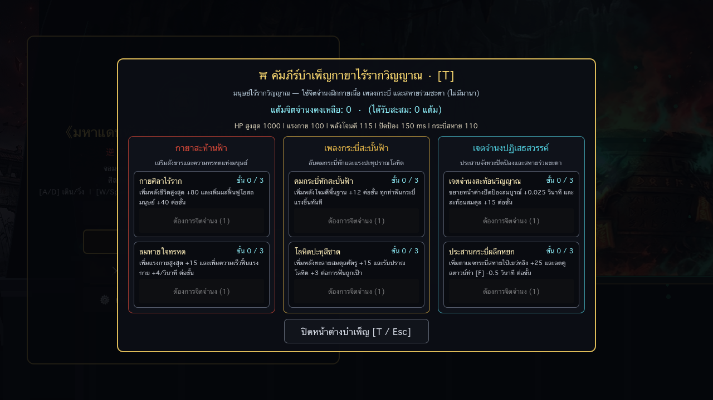

# 《มหาแดนพันภพ: ผนึกกระบี่สะบั้นสวรรค์》
### *Maha Dan Panpaph: The Heavenly Fatebreaker Sword*

[%20%7C%20Windows%20%7C%20Linux-brightgreen.svg)](#)

> **「 逆 天 改 命 · ฝืน ลิ ขิต เป ลี่ ยน ชะ ตา 」**  
> *"Defying the Heavens, Rewriting Destiny"*

Welcome to the official repository and master architectural dossier for **《มหาแดนพันภพ: ผนึกกระบี่สะบั้นสวรรค์》 (Maha Dan Panpaph: The Heavenly Fatebreaker Sword)** — an atmospheric, high-precision 2D Side-scrolling Action RPG rooted in Chinese Xianxia Dark Fantasy and classical Ink-Wash aesthetics.

---

## 🌐 Live Interactive Web Showcase & Downloads

* 🌍 **Web Showcase (GitHub Pages):** [https://carinojake.github.io/maha-dan-panpaph-dossier/](https://carinojake.github.io/maha-dan-panpaph-dossier/)
* ✨ **Interactive 60 FPS Character Model Showcase (v6 · All 5 Characters):** [character_master_showcase.html](https://carinojake.github.io/maha-dan-panpaph-dossier/character_master_showcase.html)
  * 🗡️ [Chen Xi (เฉินซี)](https://carinojake.github.io/maha-dan-panpaph-dossier/chen_xi_model_preview.html) | ❄️ [Bai Yueling (ไป๋เยว่หลิง)](https://carinojake.github.io/maha-dan-panpaph-dossier/bai_yueling_model_preview.html) | 🧿 [Song Ren (ซ่งเหริน)](https://carinojake.github.io/maha-dan-panpaph-dossier/song_ren_model_preview.html) | 👹 [Prince Ye Sangye (เยี่ยซางเยี่ย)](https://carinojake.github.io/maha-dan-panpaph-dossier/ye_sangye_model_preview.html) | 🧪 [Elder Zhao Yan (จ้าวเหยียน)](https://carinojake.github.io/maha-dan-panpaph-dossier/zhao_yan_model_preview.html)
* 📄 **Download Master Dossier (Word / .docx):** [Maha_Dan_Panpaph_Master_Dossier.docx](Maha_Dan_Panpaph_Master_Dossier.docx) *(6.3 MB)*
* 📑 **Download Master Dossier (PDF / .pdf):** [Maha_Dan_Panpaph_Master_Dossier.pdf](Maha_Dan_Panpaph_Master_Dossier.pdf) *(2.6 MB)*

---

## 🎮 Project Overview (ภาพรวมโครงการ)

**《มหาแดนพันภพ: ผนึกกระบี่สะบั้นสวรรค์》** tells the gripping journey of **Chen Xi (เฉินซี)**, a mortal youth naturally born without a Spiritual Root (ไร้รากวิญญาณตามธรรมชาติ - Canon C-021), who wields the **Broken Fatebreaker Sword (กระบี่หักสะบั้นสวรรค์ - Canon C-006, C-020)** forged from a core fragment of the shattered Heavenly Destiny Wheel.

Joined by celestial maiden **Bai Yueling (ไป๋เยว่หลิง)**, they uncover the sinister truth behind the **Soul-Refining Cauldron (เตากลืนชีวา - Canon C-013)** operated by Elder Zhao Yan, and fight to dismantle ancient divine corruption to establish a **New Heavenly Order (กฎระเบียบสวรรค์ใหม่ - Canon C-022)**.

---

## 🌟 Core Gameplay Highlights (จุดเด่นระบบการเล่น)

| Feature | Description |
|---|---|
| ⚔️ **Dual-Hero Seamless Swap** | Switch between **Chen Xi** (Weighty crimson blood qi combat & poise breaker) and **Bai Yueling** (Agile celestial frost sword, aerial crescents & hexagram arrays) instantly with `[Tab]`. |
| 🛡️ **Precision Soul Parry & Dash** | Zero-latency hitbox physics, Perfect Parry (`[L]` / `[Shift]`) that stuns enemies, and Ink Dash (`[K]`) with Invulnerability Frames (I-Frames). |
| 🧘 **Naturally Unrooted Skill Tree** | No generic EXP grinding; unlock 3 specialized branches (**Physical Fortitude**, **Fatebreaker Blade**, **Heaven-Defying Will**) via earned *Will Points*. |
| 🗺️ **Atmospheric 2D Metroidvania Levels** | 5 distinct zones in Chapter 1 (Mortal Border, 9,060px) and organic subterranean crag formations with toxic hazards in Chapter 2 (8,400px). |
| 👹 **Intelligent Boss State Machines** | Multi-phase boss encounters (Furnace Guardian & Elder Zhao Yan's Soul Projection) featuring telegraph windups, poise break recovery, and devastating cleaves. |
| 🎨 **Ink-Wash Xianxia Aesthetics** | Traditional Chinese brushstroke VFX, dynamic calligraphic HUD, antique Bagua mirror minimap, and authentic ambient guzheng instruments. |

---

## 📸 In-Game Screenshots (ภาพถ่ายหลักฐานในเกมจริง)

| แม่นางไป๋เยว่หลิง (วิชาท่องนภาเหมันต์) | ไป๋เยว่หลิง (คลื่นกระบี่หยกกลางเวหา) |
|---|---|
|  |  |

| เฉินซี (เพลงกระบี่สะบั้นพู่กันจีน) | บอสเตากลืนชีวา (ท่าง้างดาบส่งสัญญาณเตือน) |
|---|---|
|  |  |

| ถ้ำหินธรรมชาติแตกลายงา (บทที่ 2) | หน้าต่างผังบำเพ็ญตบะ (Cultivation Tree) |
|---|---|
|  |  |

---

## 📚 12 Master Dossier Modules (สารบบ 12 หมวดหมู่แม่บท)

1. **🏛️ Module 01: Lore & Canon Register** — The philosophy of `逆天改命`, 4 Dimensional Realms (Human, Immortal, Demon, God - C-018), and inviolable rules C-001 through C-022.
2. **👥 Module 02: Character Bibles** — Deep backstories, physical profiles, weapon lore, and dialogue voice styles for Chen Xi, Bai Yueling, Song Ren, Ye Sangye, and Elder Zhao Yan.
3. **⚔️ Module 03: Combat Mechanics** — Frame data, light/heavy combos, midair attacks, plunge strikes, blood qi management, and dual-hero switching.
4. **🧘 Module 04: Cultivation Progression** — Non-cultivator skill tree driven by Will Points, stat formulas, and human elixir recovery.
5. **🗺️ Module 05: Level & Environment Design** — Level 01 (Mortal Border) 5-zone progression and Level 02 (Subterranean Cavern) hazard gauntlets.
6. **👹 Module 06: Enemy & Boss Architecture** — AI state machines, poise meters, telegraph anticipation timings, and loot drops.
7. **🎨 Module 07: Visual Art & Sprite Animation** — 37 animation frames for playable Bai Yueling, squash & stretch kinematics, and brushstroke VFX.
8. **🎵 Module 08: Audio & Sound Direction** — Dynamic multi-layered ambient guzheng music and metallic clang parry sound design.
9. **🖥️ Module 09: UI / UX Architecture** — Calligraphic bronze HUD, Bagua divination minimap, and touch-friendly mobile layouts.
10. **⚙️ Module 10: Technical Engine Architecture** — Godot 4.7 pure GDScript structure, headless smoke test pipeline, and Apple Silicon M1 zero-stutter optimizations.
11. **💾 Module 11: Save System & Settings** — Local JSON save serialization (`user://save_data.json`) and customizable key rebinding.
12. **🚀 Module 12: Roadmap & Creator Task Menu** — Milestone tracking and creator-tailored work packages for Executive Producer พี่แจ็ค.

---

## 🕹️ Controls Map (ผังปุ่มควบคุมมาตรฐาน)

| Key (Keyboard) | Gamepad | Action | รายละเอียด |
|---|---|---|---|
| **`[A]` / `[D]`** | Left Stick / D-Pad | Move Left / Right | เคลื่อนที่ซ้าย / ขวา |
| **`[W]` / `[Space]`** | Button A | Jump | กระโดด (Coyote Time & Variable Height) |
| **`[K]`** | Right Trigger / B | Dash | พุ่งหลบเงาหมึก (I-Frames 0.28s) |
| **`[J]`** / Left Click | Button X | Light Attack | คอมโบกระบี่ 3 จังหวะ |
| **`[I]`** / Right Click | Button Y | Heavy Attack | สะบั้นหนักทำลายเกราะ Poise |
| **`[L]`** / `[Shift]` | Left Bumper | Soul Parry | ปัดป้องวิญญาณสะท้อนดาเมจ |
| **`[U]`** | Right Bumper | Ultimate Cleave | ปราณโลหิตสะบั้นสวรรค์ / ค่ายกล 6 ทิศ |
| **`[Tab]`** | Select / Back | **Switch Hero** | **สลับตัวละคร (เฉินซี ⇄ ไป๋เยว่หลิง)** |
| **`[Q]`** | D-Pad Down | Use Elixir | ดื่มน้ำเต้าโอสถฟื้นเลือด 30% |
| **`[T]`** | D-Pad Up | Cultivation Tree | เปิด/ปิดผังบำเพ็ญตบะ |
| **`[E]`** | Button Y (Near Prop) | Interact | สนทนา / อ่านศิลาจารึกโบราณ |
| **`[H]`** | — | Controls Guide | เปิดคัมภีร์คู่มือช่วยเหลือ |
| **`[Esc]`** | Start | Pause Menu | พักเกม / ตั้งค่า / บันทึกด่วน [F5] |

---

## 💻 Technical Stack & Engine

* **Engine:** Godot Engine 4.7 Stable (Pure GDScript Architecture)
* **Target Platforms:** macOS Apple Silicon (M1 / M2 / M3 / M4), PC Windows x64, Linux
* **Performance Profile:** Rock-solid 60 FPS at < 40% CPU utilization on Apple Silicon M1
* **Audio Engine:** Centralized non-blocking zero-latency pooled audio pipeline
* **Save Engine:** Isolated JSON serialization with atomic writes and schema versioning

---

## 👥 Credits & Governance (คณะผู้จัดทำ)

* **Executive Producer & Project Creator:** พี่แจ็ค (Jake)
* **Development Council:** สภา AI Agent 13 ตำแหน่ง + ซีเนียร์วิศวกร (Senior Staff Engineer - Poteto-Mode)
* **Universe Canon:** Governed strictly by **World Bible v1.2** and **Canon Register C-001 through C-022**

---

*For detailed technical enquiries or design adjustments, refer to the full [Master Dossier (DOCX)](Maha_Dan_Panpaph_Master_Dossier.docx) or explore the [Interactive Website](https://carinojake.github.io/maha-dan-panpaph-dossier/).*
